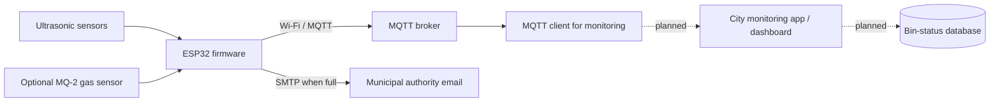

# Smart Dustbin for City Waste Management

An ESP32/IoT prototype for monitoring waste-bin fill levels and notifying municipal staff when a bin needs collection. The project combines firmware experiments with the system-design presentation and diagrams prepared for the System Design, Engineering, and Testing course.

## Abstract

Traditional waste collection often relies on fixed schedules and manual inspection, which can leave bins overflowing while collection teams spend time checking bins that are not yet full. This project explores a smart-bin approach: ultrasonic sensors measure the distance to the waste, an ESP32 sends readings over Wi-Fi to an MQTT broker, and the firmware sends an email when a configured full-bin threshold is reached. A separate firmware variant also reads an MQ-2 gas sensor. The accompanying presentation describes a broader city waste-management system; mobile-app monitoring, a cloud database, route optimization, and SMS notifications remain proposed extensions rather than implemented features in the current firmware.

## System overview

### Current implementation

- Two ultrasonic sensors are read by the integrated MQTT sketches.
- Readings are published to `device/dustbin1` or `device/dustbin2`.
- The firmware sends an email when the mean sensor distance is below `4 cm`.
- `Using_MQTT/Using_MQTT.ino` also reads an MQ-2 sensor on GPIO 34 and includes its reading in the MQTT message.
- `Using_MQTT_2/Using_MQTT_2.ino` is the second-bin variant and publishes fill-level data without the gas reading.

The threshold and sensor placement need to be calibrated for the physical bin. The firmware is a prototype, not a production-ready city deployment.

## Repository contents

| Path | Description |
| --- | --- |
| `Using_MQTT/` | Integrated first-bin firmware: ultrasonic sensors, MQ-2, MQTT, and email alert |
| `Using_MQTT_2/` | Integrated second-bin firmware: ultrasonic sensors, MQTT, and email alert |
| `Gas/` | Standalone MQ-2 serial-reading experiment |
| `email/` | Standalone ESP32 SMTP email experiment |
| `sketch_aug5a/` | Standalone two-ultrasonic-sensor experiment |
| `docs/Project-Progress.pptx` | Original project presentation |
| `docs/system-design.md` | Abstract, requirements, architecture, and implementation status |
| `docs/diagrams/` | Context/DFD and use-case diagram PDFs |
| `credentials.example.h` | Safe template for local Wi-Fi and email configuration |

## Hardware

The integrated sketches use the following ESP32 GPIO assignments:

| Component | ESP32 GPIO |
| --- | ---: |
| Ultrasonic sensor 1 — TRIG | 5 |
| Ultrasonic sensor 1 — ECHO | 18 |
| Ultrasonic sensor 2 — TRIG | 14 |
| Ultrasonic sensor 2 — ECHO | 27 |
| MQ-2 analog output (first-bin sketch only) | 34 |

Check the sensor module's voltage requirements and use appropriate level shifting for ESP32 input pins. The sketches do not implement voltage protection.

## Build and configure

1. Install the Arduino IDE and ESP32 board support.
2. Install the `PubSubClient` and `ESP Mail Client` Arduino libraries for the integrated MQTT/email sketches. The standalone sensor sketches need no additional library beyond ESP32 board support.
3. Copy `credentials.example.h` to `credentials.h` in each sketch folder you intend to build: `Using_MQTT/`, `Using_MQTT_2/`, and/or `email/`.
4. Edit that local `credentials.h` with your own Wi-Fi and email settings. `credentials.h` is ignored by Git and must not be committed.
5. Open the `.ino` file from its matching folder in Arduino IDE, select your ESP32 board and port, then compile and upload.
6. Subscribe with an MQTT client to `device/dustbin1` or `device/dustbin2` to inspect telemetry.

The integrated sketches currently use the public broker `broker.emqx.io` on port `1883`. Public, unencrypted MQTT is suitable only for a demonstration; use an authenticated broker with TLS for a real deployment.

> **Credential safety:** Credentials previously present in this project's source may remain visible in older Git revisions. Rotate any Wi-Fi or email credentials that were ever committed. Removing them from the latest files does not remove them from Git history.

## Design documents

- [System design and implementation status](docs/system-design.md)
- [DFD Level 0 / context diagram](docs/diagrams/DFD-Level-0.pdf)
- [DFD Level 1](docs/diagrams/DFD-Level-1.pdf)
- [Use-case diagram](docs/diagrams/Use-Case-Diagram.pdf)
- [Project progress presentation](docs/Project-Progress.pptx)

The PDFs and presentation are included as supplied project documents. The design document distinguishes their wider proposed system from the features present in the firmware.
