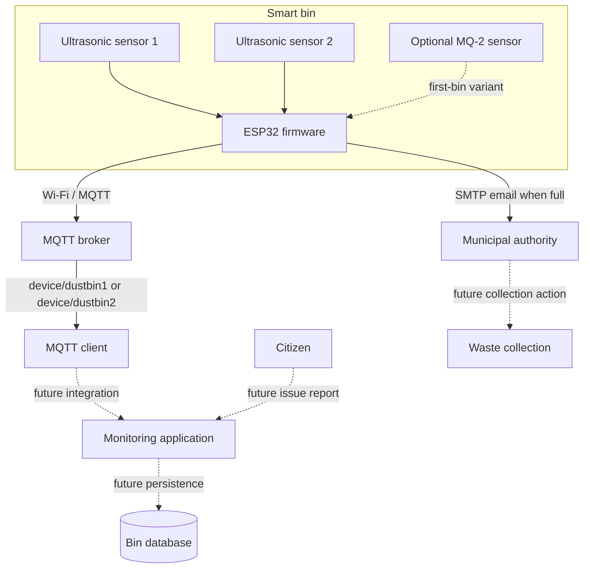

# System Design

## Abstract

This project prototypes an IoT-based waste-bin monitoring system for city waste collection. Ultrasonic sensors estimate the distance from the top of a bin to its contents. An ESP32 reads the sensors and sends telemetry over Wi-Fi using MQTT. When the average measured distance falls below a configured threshold, the firmware sends an email notification to a municipal contact. One firmware variant also reads an MQ-2 gas sensor and reports its analog value. The project presentation and diagrams describe a broader system that could include citizen issue reports, a monitoring application, cloud storage, route optimization, and SMS alerts; these are design proposals and are not implemented by the current sketches.

## Problem and objectives

Manual inspection and fixed collection schedules can lead to overflowing bins, unnecessary collection trips, and delayed response to reported issues. The prototype explores:

- measuring bin fill level with low-cost sensors;
- transmitting sensor readings for remote monitoring;
- notifying a configured recipient when a bin crosses a fill threshold; and
- documenting how the prototype could grow into a multi-bin city service.

## Requirements

### Functional requirements in the firmware

1. Read two ultrasonic sensors on each integrated bin sketch.
2. Publish sensor data periodically to the bin's MQTT topic.
3. Send an email when the average measured distance is below the configured `4 cm` threshold.
4. In the first-bin variant, read and publish the MQ-2 analog value.

### Proposed requirements from the presentation

The presentation also proposes a city monitoring application, persistent cloud storage, SMS alerts, repeated reminders for uncleared bins, and support for city-wide deployment. These items are not implemented in the current repository and should be treated as future requirements.

### Quality goals

The presentation identifies low-latency communication, secure/scalable storage, reliable messaging, energy efficiency, and ease of use as goals. The current prototype uses a public, non-TLS MQTT broker and does not implement a database, authentication, or a user interface, so it does not yet meet production security or scalability needs.

## Architecture and data flow

### Firmware flow

1. The ESP32 connects to the configured Wi-Fi network and MQTT broker.
2. At roughly two-second intervals, the integrated sketch reads both ultrasonic sensors and calculates their mean distance.
3. It publishes readings to the bin's MQTT topic. The first-bin variant includes the MQ-2 analog reading.
4. If the mean distance is under `4 cm`, the sketch publishes a full-bin message and attempts to send an email via SMTP.

The threshold is a prototype value and must be calibrated against the bin geometry and sensor mounting. The current firmware also needs more robust handling of sensor timeouts and network/email failures before field use.

## Interfaces and hardware mapping

| Interface | Assignment / value |
| --- | --- |
| Ultrasonic sensor 1 | TRIG GPIO 5, ECHO GPIO 18 |
| Ultrasonic sensor 2 | TRIG GPIO 14, ECHO GPIO 27 |
| MQ-2 analog output | GPIO 34; first-bin firmware variant |
| MQTT topics | `device/dustbin1`, `device/dustbin2` |
| MQTT broker | `broker.emqx.io:1883` (prototype setting) |
| Email transport | SMTP, configured locally in `credentials.h` |

## Design artefacts

- [DFD Level 0 / context diagram](diagrams/DFD-Level-0.pdf)
- [DFD Level 1](diagrams/DFD-Level-1.pdf)
- [Use-case diagram](diagrams/Use-Case-Diagram.pdf)
- [Project progress presentation](Project-Progress.pptx)

The supplied diagrams contain system elements such as a citizen mobile app, cloud database, and collection workflow that are broader than the present firmware implementation.

## Risks and future work

- Calibrate sensors and distinguish a genuine full-bin reading from a timeout or disconnected sensor.
- Add MQTT authentication and TLS; avoid sending telemetry through an unauthenticated public broker.
- Add persistent storage, a monitoring interface, and authenticated access if city-wide monitoring is developed.
- Replace direct email-only alerts with a managed notification service and retry/acknowledgment handling.
- Validate sensor power, environmental durability, electrical safety, and alert thresholds in a field prototype.
- Consider the presentation's proposed mobile app, route optimization, repeat reminders, and solar power only as future scope.
